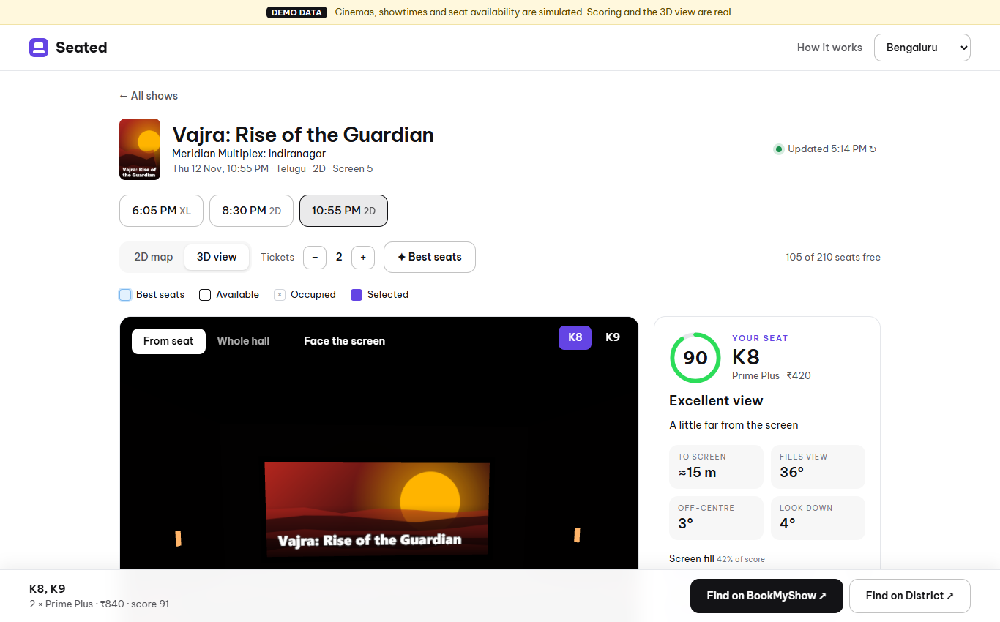
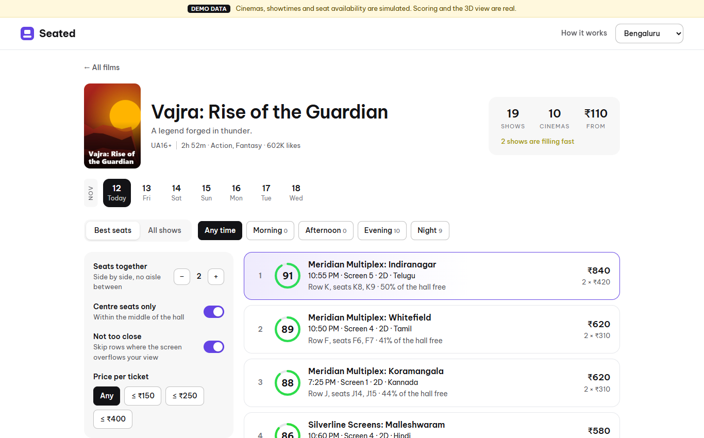
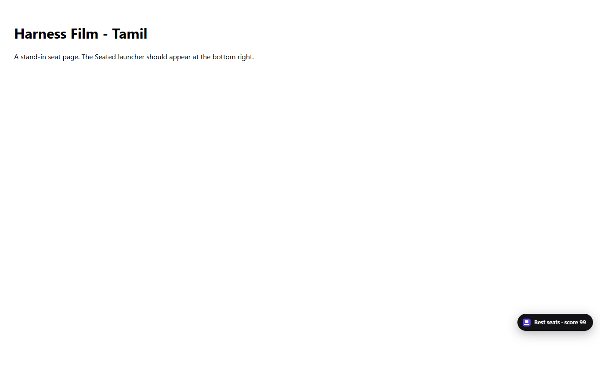
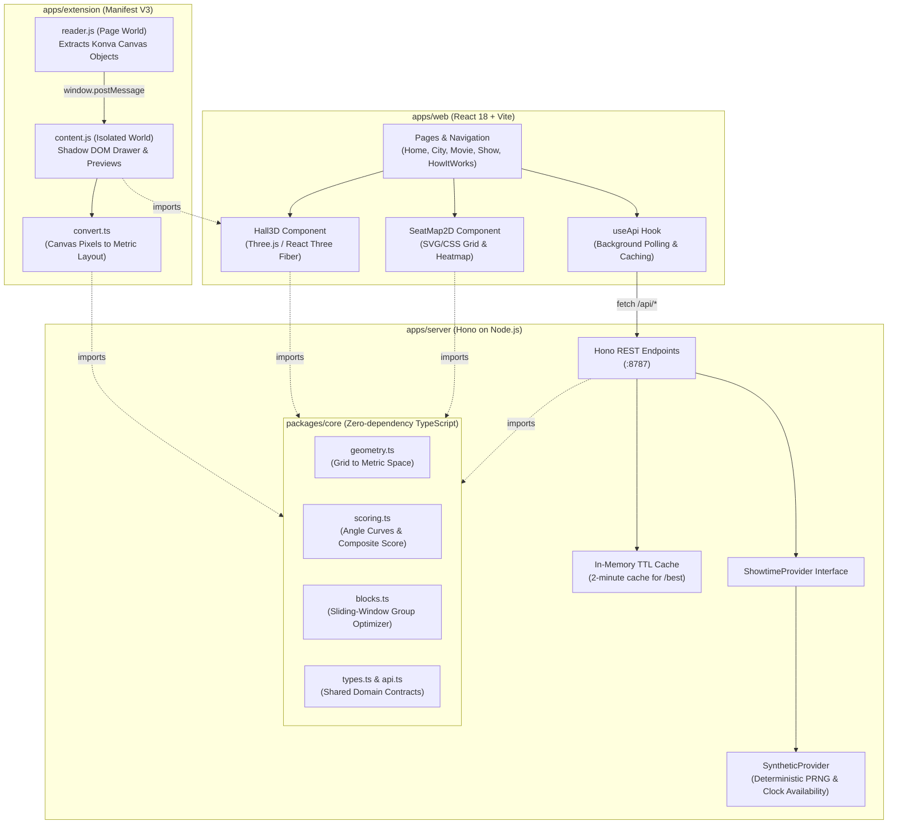

# Seated

Find the best cinema seats still free for any show, and preview the view from them in 3D before you book.


> [!NOTE]
> **Data transparency:** The web app runs on deterministic simulated data (procedural cinemas, films, and clock-driven availability); only the geometric scoring engine and 3D hall rendering are live. Seated does **not** scrape BookMyShow or District servers. Real booking data is read exclusively on the client side through the Chrome extension, inspecting the seat map already rendered in the user's browser.

---

## Preview

| 3D View from Selected Seat | Film Showtimes & Best Blocks | Extension on BookMyShow |
| :---: | :---: | :---: |
|  |  |  |

---

## The Problem and the Idea

Ticketing platforms like BookMyShow and District show you *which seats are free*, but never *which free seats are actually good*. Moviegoers are forced to guess distance, screen tilt, and sightlines from flat 2D seating grids, often ending up with neck strain or severe angular distortion.

Seated introduces a recommendation and spatial preview layer on top of ticket booking. It translates 2D seat layouts into 3D metric hall coordinates, calculates viewing angles based on human visual comfort research, and produces an explainable 0–100 score for every seat. Whether browsing all showtimes in a city to find the best remaining seats or buying on BookMyShow with the companion Chrome extension, users can preview the exact view from their seat before spending money.

---

## Features

### Web Application
- **City & catalogue discovery:** Browse shows across 10 cities with date, time-of-day, language, genre, and price filters.
- **Ranked showtime discovery (`/best`):** Automatically scores every free seat across all shows for a film, ranking showtimes by their highest-scoring block of $N$ adjacent seats.
- **Synchronized 2D and 3D maps:** Switch seamlessly between a top-down seat grid (with sweet-spot boundary and optional score heat map) and an interactive 3D WebGL auditorium. Tapping a seat in either view synchronizes the selection.
- **First-person seat view & orbit mode:** Sit in any seat with head-rotation controls clamped to natural viewing ranges, or orbit around the entire auditorium shell.
- **Explainable score breakdowns:** Inspect the three underlying viewing angles, sub-scores, distance to screen, and an English explanation for any seat (e.g., *"Sweet spot: centred, and the screen fills your view"*).
- **Smart group selection:** Tapping any seat automatically selects the best adjacent block of $N$ seats around it, skipping sold seats and aisle boundaries.
- **Booking hand-off:** Direct outbound hand-off buttons to BookMyShow and District search listings.

### Chrome Extension
- **Non-intrusive launcher button:** Injects a floating "Best seats" trigger on BookMyShow seat selection pages (`in.bookmyshow.com`), displaying the highest score available in the hall.
- **Sliding drawer panel:** Opens a side panel listing the top four seat blocks across different rows, filterable by group size (1 to 10), centre preference, and proximity.
- **Embedded 3D preview:** Renders the 3D auditorium view for chosen BookMyShow seats directly inside the booking flow, complete with the active film title on screen.
- **Live re-scoring:** Continuously re-reads the page canvas state every 1.5 seconds. If other users book seats, the ranking recalculates instantly.
- **Shadow DOM isolation:** Mounts within a Shadow Root to ensure complete CSS and script encapsulation from BookMyShow's host styles.

---

## How the Score Works

The scoring engine reconstructs the auditorium in metric space, assuming standard multiplex geometry unless explicit exhibitor dimensions are provided. It evaluates each seat across three primary viewing factors:

| Factor | Weight | Formula / Measurement | Comfortable Range | Penalty Behaviour |
| :--- | :---: | :--- | :--- | :--- |
| **Screen fill** | 42% | Horizontal visual angle subtended by screen: $\Delta\theta_h = \arctan\left(\frac{W/2 - x}{z}\right) - \arctan\left(\frac{-W/2 - x}{z}\right)$ | 36°–55° (peaks at 44°) | Steep drop-off if $>60^\circ$ (screen overflows field of view); moderate drop-off if too distant ($<30^\circ$). |
| **Centring** | 38% | Angle off the screen centre line: $\theta_c = \arctan\left(\frac{\|x\|}{z}\right)$ | $\le 13^\circ$ | Progressive penalty as lateral angle increases; drops to 0 at $40^\circ$. |
| **Neck angle** | 20% | Vertical angle to screen centre: $\theta_v = \arctan\left(\frac{y_{\text{screen}} - y_{\text{eye}}}{z}\right)$ | $\le 6^\circ$ | Downward tilt from stadium tiers counts at half penalty; upward tilt drops sharply past $15^\circ$. |

Each raw angle is transformed into a 0–100 sub-score via piecewise linear interpolation curves, and combined into a final weighted score:

$$\text{Score} = 0.42 \times S_{\text{fill}} + 0.38 \times S_{\text{centre}} + 0.20 \times S_{\text{neck}}$$

Seats scoring 85+ earn the **"Sweet Spot"** verdict. When selecting blocks of $N$ seats, Seated ranks by average score, breaks ties by the weakest seat in the block, and applies a subtle penalty to configurations that leave isolated single empty seats.

### Hall-Size Baseline Assumptions
When exhibitors do not supply surveyed room dimensions, `@seated/core` projects physical coordinates using standard cinema architectural standards:
- **Seat spacing (pitch):** 0.56 m centre-to-centre
- **Row depth:** 1.05 m per row
- **Row rise:** 0.30 m elevation step per row
- **Screen dimensions:** Width at 85% of seating width; 2.39:1 Scope aspect ratio
- **Front row distance:** 0.45 screen widths from the screen
- **Eye level:** 1.15 m above floor height; screen base 1.0 m above row 1 floor

For full mathematical derivations and curve definitions, see [PROJECT_GUIDE.md](PROJECT_GUIDE.md#6-the-scoring-engine-in-depth).

---

## Architecture

Seated is structured as an npm-workspaces monorepo designed around one core principle: **identical scoring logic shared everywhere with zero network roundtrips.**



### Key Design Decisions

1. **Scoring engine on client and server:** `@seated/core` has zero runtime dependencies and compiles directly into both Node.js and browser bundles. The server uses it to rank dozens of showtimes in parallel, while the web client and Chrome extension use it to recalculate seat rankings in under 2 ms upon every user tap.
2. **Provider interface pattern:** The API server relies strictly on the `ShowtimeProvider` interface (`apps/server/src/providers/types.ts`). The current implementation (`SyntheticProvider`) generates deterministic cinemas, halls, and clock-dependent sell orders via seeded PRNG (`util.ts`). Connecting a live licensed feed or ticketing API requires implementing this single interface without modifying routes or UI.
3. **Geometry separated from availability:** A hall's physical envelope is immutable; seat occupancy changes minute-by-minute. The engine calculates geometry once and layers availability masks on top, keeping geometry calculations cached.
4. **Zero-scraping client-side extension:** Rather than running unauthorized scrapers against BookMyShow's anti-bot infrastructure, real-world data extraction runs purely inside the user's browser session.

---

## Tech Stack

| Layer | Technology | Why Chosen |
| :--- | :--- | :--- |
| **Monorepo** | npm workspaces | Native monorepo tooling without the overhead of external orchestration tools. |
| **Language** | TypeScript 5.6 (Strict) | Enables sharing exact interfaces (`SeatLayout`, `SeatScore`, `ShowSummary`) across server, client, and extension. |
| **Scoring Engine** | Vanilla TypeScript | Zero dependencies; evaluates thousands of seat combinations per second in any JS runtime. |
| **API Server** | Hono (Node adapter) + tsx | Ultra-lightweight route definitions, fast startup, and native JSON ergonomics. |
| **Web Frontend** | React 18 + Vite | Rapid Hot Module Replacement and modular tree-shaking for modern SPAs. |
| **3D Graphics** | Three.js + React Three Fiber + Drei | Declarative component-based WebGL scene graph; instanced mesh rendering draws hundreds of seats in 2 draw calls. |
| **Styling** | Plain CSS Custom Properties | District-inspired clean design language with zero CSS-in-JS runtime overhead or build-tool locks. |
| **Extension Bundler** | esbuild | High-speed bundling of multi-world scripts into independent, self-contained files compliant with Manifest V3. |
| **Testing** | Vitest | Instant TypeScript unit test execution with zero config transformation overhead. |

---

## Getting Started

### Prerequisites
- **Node.js**: `v20.0.0` or higher
- **npm**: `v10.0.0` or higher

### 1. Installation
Clone the repository and install all workspace dependencies:
```bash
git clone https://github.com/deonbinny7/seated.git
cd seated
npm install
```

### 2. Development Mode
Run both the API server and the Vite dev server concurrently:
```bash
npm run dev
```
- **Web client:** [http://localhost:5173](http://localhost:5173)
- **API server:** [http://localhost:8787](http://localhost:8787) (proxied automatically through Vite at `/api/*`)

### 3. Unit Tests & Typecheck
Run the scoring engine unit test suite:
```bash
npm test
```
Verify TypeScript types across all four workspaces (`core`, `server`, `web`, `extension`):
```bash
npm run typecheck
```

### 4. Production Builds
Build the web application:
```bash
npm run build
```
Bundle the Chrome extension:
```bash
npm run build:extension
```
The compiled extension output is generated at `apps/extension/dist/`.

### 5. Installing the Extension in Chrome
1. Open Google Chrome and navigate to `chrome://extensions/`.
2. Toggle **Developer mode** on in the top-right corner.
3. Click **Load unpacked** in the top-left toolbar.
4. Select the `apps/extension/dist` folder inside this repository.
5. Visit any movie seat-layout page on `in.bookmyshow.com`. Once the canvas loads, the purple **Best seats** button will appear at the bottom right.
6. *(Optional)* To test without BookMyShow, run `python -m http.server 5180 --directory apps/extension/dist` and open `http://localhost:5180/harness.html`.

---

## Deployment

The web app deploys as two free services: the API on Render and the front end on Vercel.

**1. API on Render**

1. Push this repository to GitHub.
2. In Render, choose **New → Blueprint** and select the repository. `render.yaml` sets the build command (`npm install`), start command (`npm run start -w @seated/server`), Node version and health check.
3. When it is live, copy the service address, for example `https://seated-api.onrender.com`. Opening `/api/health` on it should return `{"ok":true}`.

**2. Front end on Vercel**

1. In Vercel, choose **Add New → Project** and import the same repository.
2. Set **Root Directory** to `apps/web`. The framework (Vite), build command and output folder come from `apps/web/vercel.json`.
3. Add an environment variable `VITE_API_URL` with the Render address from step 1, with no trailing slash.
4. Deploy.

`VITE_API_URL` is read when the site is built, so redeploy on Vercel after changing it.

Notes:

- Render's free plan puts the API to sleep after about 15 minutes without traffic. The next visit takes up to a minute while it wakes, and the site shows a "waking the server up" message meanwhile.
- The API allows requests from any origin by default. To restrict it to your site, set `ALLOWED_ORIGIN` on Render to your Vercel address (comma-separated for more than one).

## Project Structure

```text
seated/
├── packages/
│   └── core/                     # Shared scoring engine (zero dependencies)
│       ├── src/
│       │   ├── geometry.ts       # Rebuilds hall grid into 3D metric coordinates
│       │   ├── scoring.ts        # Viewing angle sub-score curves & composite score
│       │   ├── blocks.ts         # Adjacent seat finder & multi-row ranking
│       │   ├── types.ts          # Core domain models (Seat, HallSpec, SeatScore)
│       │   └── api.ts            # Contract types shared between API and frontend
│       └── test/                 # 10 Vitest unit tests verifying math & symmetry
├── apps/
│   ├── server/                   # Hono API server (port 8787)
│   │   └── src/
│   │       ├── index.ts          # REST routes (/api/cities, /movies, /best, /shows)
│   │       ├── util.ts           # Seeded PRNG, IST time tools, in-memory TTL cache
│   │       ├── links.ts          # BookMyShow & District outbound deep-link builder
│   │       └── providers/        # ShowtimeProvider interface & Synthetic generator
│   ├── web/                      # React 18 + Vite frontend (port 5173)
│   │   ├── src/
│   │   │   ├── components/       # SeatMap2D, Hall3D (instanced Three.js), ScoreRing
│   │   │   ├── pages/            # Home, CityPage, MoviePage, ShowPage, HowItWorks
│   │   │   ├── poster.ts         # Procedural canvas movie artwork generator
│   │   │   └── styles.css        # Global CSS variables & layout system
│   │   └── vite.config.ts        # Dev server proxy configuration
│   └── extension/                # Chrome Extension (Manifest V3)
│       ├── src/
│       │   ├── reader.ts         # MAIN world script: extracts canvas Konva objects
│       │   ├── content.tsx       # ISOLATED world script: shadow-DOM UI drawer
│       │   ├── convert.ts        # Normalizes raw pixel coordinates into seat grid
│       │   └── protocol.ts       # Cross-world postMessage contracts
│       ├── harness.html          # Standalone testbed replaying captured seat maps
│       └── build.mjs             # esbuild compilation script
├── PROJECT_GUIDE.md              # Complete technical architecture & codebase reference
└── package.json                  # Monorepo workspaces & top-level scripts
```

---

## Deep Dive: Extracting BookMyShow's Canvas-Drawn Seat Map

On BookMyShow, seating layouts are not DOM nodes—they are drawn directly onto an HTML `<canvas>` using the **Konva** canvas rendering framework. Standard DOM scrapers and extension content scripts cannot see any seat elements.

To solve this without inspecting network traffic, Seated uses a dual-world architecture:

1. **Page World (`reader.ts` in `MAIN` world):** Injected directly into the host execution context, where it has access to the window scope. Konva maintains all rendered canvas objects in memory. The reader traverses Konva's stage tree, locating seat groups whose custom `seatObj` property holds the seat's row letter, column, pricing category, and availability flag (`1 = available`).
2. **Startup Handshake:** The reader starts before the UI panel bundle finishes loading. To prevent race conditions where the initial payload is missed, the panel posts a `PANEL_READY` message via `window.postMessage`, prompting the reader to re-broadcast the active seat map immediately.
3. **Coordinate Transformation (`convert.ts`):** 
   - **Aisle detection:** Calculates the smallest difference between adjacent $x$ coordinates to determine seat pitch; any gap exceeding $1.4\times$ pitch is categorized as an aisle.
   - **Screen orientation inversion:** BookMyShow draws the cinema screen at the bottom of the canvas, whereas standard audience perspective places the screen forward. The converter inverts row order and mirrors columns so that the resulting 3D view is physically accurate to sitting in the hall.

---

## Verification & Testing

### Automated Test Suite
Run with `npm test`. 10 unit tests in `packages/core/test/core.test.ts` verify mathematical invariants:
- **Curve interpolation:** Boundary conditions and linear clamping across fill, centring, and neck curves.
- **Physical geometry:** Accuracy of metric projections and user-specified `HallSpec` overrides.
- **Left-right symmetry:** Ensuring identical seats on left and right flanks receive matching scores.
- **Monotonicity:** Confirming centre-row seats consistently outscore front-row corners.
- **Aisle isolation:** Guaranteeing blocks never span across aisles, columns, or occupied seats.
- **Ranking order:** Validating that block recommendations sort by average score, weakest seat, and price.

### Manual Verification
- **Web client:** End-to-end user journey verified in modern Chromium browsers (city switching, responsive collapsing, heat map toggle, and 3D raycasting seat selection).
- **Extension canvas reader:** Tested against live BookMyShow shows, successfully parsing all 272 seats (234 free) and producing recommendations matching known benchmarks (Row T seats 5–6).
- **Extension standalone harness:** Verified against captured seat layouts via `apps/extension/harness.html`.

### Known Unverified Scenarios
- **Live combined extension flow:** While the reader and isolated panel pass tests independently on live pages, full end-to-end automated testing inside Chrome against real BookMyShow shows remains manual due to BookMyShow's bot protection blocking automated Chromium instances.
- **Wide desktop viewport regression testing:** The web application was visually refined on narrow-to-medium viewports; wide-screen ultra-wide desktop views have not undergone formal design review.

---

## Limitations & Roadmap

### Current Limitations
- **Simulated catalogue:** The web app uses procedurally generated showtimes and occupancy curves. Real cinema feeds require implementing a custom `ShowtimeProvider`.
- **Approximated hall dimensions:** Seat pitch and screen elevation are based on multiplex standards. Specific auditoriums may feature non-standard rakes or screen curvatures.
- **Platform dependency:** The extension relies on BookMyShow's internal Konva data properties. An internal refactor by BookMyShow could necessitate updates to `reader.ts`.

### Roadmap
- [ ] Expand Chrome extension support to District's seat-selection interface.
- [ ] Direct visual overlays highlighting recommended seats directly on BookMyShow's native canvas.
- [ ] Real film metadata and poster integration via TMDB API.
- [ ] Exhibitor analytics dashboard to calculate occupancy yield against seat score tiers.
- [ ] Accessibility-aware filtering (step-free access, wheelchair companion seating, extra legroom).

---

## Disclaimer & Licence

### Disclaimer
Seated is an independent educational and research project created for learning and portfolio demonstration. It is **not affiliated with, endorsed by, or associated with** seats.movie, BookMyShow, Bigtree Entertainment Pvt. Ltd., District, or any cinema exhibitor.

### Licence
This project does not currently have an open-source licence specified. All rights are reserved by the author. An open-source licence (such as the MIT Licence) may be added in a future release.
